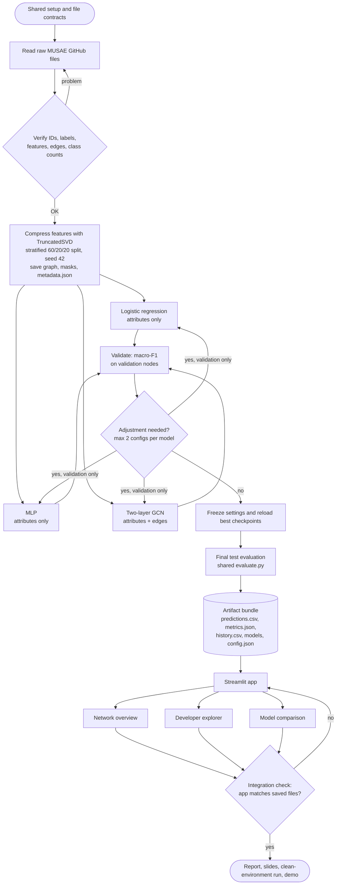

# Developer Network Explorer

An interactive Streamlit app that explores a GitHub developer network and shows how three machine learning models classify developers, so you can see for yourself whether using the network connections helps.

> **Status:** one-week team project (24-30 person-hours, 3 members). Results are saved evaluations on a single fixed split and seed. They do not establish that any model is generally better.

---

## 1. What is this project?

Imagine a map of developers. Each **node** is a developer, each **edge** is a mutual-follower connection, **features** are numerical attributes of the developer, and the **label** is the category we want to predict (the dataset separates *web* developers from *machine learning* developers).

Some classifiers look only at a developer's own attributes. A **Graph Convolutional Network (GCN)** also looks at the developer's neighbours. This project turns that difference into a visual demonstration:

- pick a developer who was held out for testing,
- see what each model predicted and what the dataset recorded,
- look at a small neighbourhood of connected developers,
- compare overall accuracy and macro-F1 across models.

**Who is it for?** Students and evaluators learning how graph-based classification works.

**What it is not:** a live GitHub profiling or hiring tool. It runs on a fixed dataset, uses fixed node IDs, and has no live username lookup. The neighbourhood drawing is context, not an explanation of a prediction.

### Models compared

| Model | Information used | Why it is included |
| --- | --- | --- |
| Logistic regression | Developer attributes | Simple baseline |
| MLP | Developer attributes | What a neural model can do without edges |
| Two-layer GCN | Attributes **and** edges | Learning from the network |

### Application views

| View | What you see |
| --- | --- |
| **Network overview** | Actual loaded node and edge counts, feature count, class distribution, split sizes, a small connected graph sample |
| **Developer explorer** | Select a test-node ID (optionally only those where models disagree), see the three predictions next to the recorded label, plus a capped one-hop neighbourhood (max 50 nodes, labelled as a sample when truncated) |
| **Model comparison** | Accuracy and macro-F1 per model, per-class results, a selectable confusion matrix, neural training curves |

### Data

The **MUSAE GitHub Web and ML Developers** dataset (Rozemberczki, Allen and Sarkar), read from the raw files the authors publish at [github.com/benedekrozemberczki/musae](https://github.com/benedekrozemberczki/musae). This is the same graph that PyTorch Geometric distributes as `torch_geometric.datasets.GitHub`; we read the raw files directly because PyG's download server was unreachable on our network.

| | Value (from the loaded data) |
| --- | --- |
| Developers (nodes) | 37,700 |
| Mutual-follower connections (edges) | 289,003 |
| Classes | web 27,961 (74%), ml 9,739 (26%) |
| Raw features | 4,005 binary attributes, about 18 active per developer |
| Features used | 128 (TruncatedSVD of the raw attributes) |

The app always shows the numbers from `artifacts/metadata.json`, not from this table.

### Method in brief

- **Preprocessing:** the binary attribute lists are turned into a 0/1 matrix and compressed to 128 dimensions with TruncatedSVD (seed 42). This step is unsupervised: labels are never used. Edges are stored in both directions, with duplicates and self-loops removed.
- **Split:** fixed, stratified **60/20/20** train/validation/test split (seed 42), shared by all models.
- **Fitting:** only training labels are used. Feature scaling (mean and standard deviation) is computed on training nodes only.
- **Selection:** each model tries at most two settings (*plain* and *class-weighted*), chosen by validation macro-F1. Neural checkpoints are chosen by the best validation epoch, then reloaded from disk. The test set is evaluated once, last, through the shared `evaluate.py`.
- **Transductive GCN:** the full graph and features are visible, but validation and test labels never enter the training loss.
- **Neural settings (not claimed optimal):** hidden width 32, ReLU, dropout 0.5, Adam (lr 0.01, weight decay 0.0005), up to 200 epochs, early stopping after 20 epochs without improvement. MLP and GCN share every setting; the only difference is that the GCN uses the edges.
- Training runs separately from the app. The app only loads saved results, so it needs no GPU.

### Tech stack

Python, NumPy, SciPy, pandas, scikit-learn, PyTorch, PyTorch Geometric, Streamlit, NetworkX, Matplotlib.

---

## 2. Results

Test-set results from one split (seed 42). Generated from `artifacts/metrics.json`; see section 7 for the command.

<!-- RESULTS TABLE: paste the output of the command in section 7 here -->

These numbers come from a single split and seed with at most two settings per model. Small differences between models should not be read as general superiority.

---

## 3. Project flowchart

Training runs offline. The app only reads the saved artifact bundle.



### Project structure

```
Developer_Network_Explorer/
├── data.py              read raw files, verify, compress features, split, save
├── evaluate.py          shared scoring and saving (accuracy, macro-F1, confusion matrix)
├── train_baseline.py    logistic regression
├── train_neural.py      MLP and GCN, early stopping, training history
├── app.py               Streamlit app (three views)
├── requirements.txt
├── data/                raw dataset clone (git-ignored)
└── artifacts/           saved outputs, committed so the app runs without retraining
    ├── graph_data.pt  splits.npz  metadata.json
    ├── predictions.csv  metrics.json  history.csv  config.json
    └── models/          lr.joblib  mlp.pt  gcn.pt
```

### Artifact bundle (the contract between training and the app)

| File | Contents | Written by |
| --- | --- | --- |
| `graph_data.pt`, `splits.npz` | `x [N,F]`, `edge_index [2,E]`, `y [N]`; saved train/val/test masks | `data.py` |
| `metadata.json` | Data source, actual dimensions, class mapping, node-ID convention, seed, preprocessing, versions | `data.py` |
| `predictions.csv` | `node_id, split, true_label, lr_pred, mlp_pred, gcn_pred` | each training script, via `evaluate.py` |
| `metrics.json` | Per-model test and validation accuracy, macro-F1, per-class scores, confusion matrix (same class order) | each training script, via `evaluate.py` |
| `history.csv` | `model, epoch, train_loss, val_macro_f1` for the neural models | `train_neural.py` |
| `models/`, `config.json` | Saved LR/MLP/GCN models, chosen settings, package versions | training scripts |

---

## 4. Work division

| Member | Registration | Primary ownership |
| --- | --- | --- |
| **Shreyas** | 240905118 | Environment and `requirements.txt`, data pipeline, split and metadata, logistic regression, node-alignment checks |
| **Medhavi** | 240905122 | MLP and GCN training, validation and checkpointing, training-history export, training and checkpoint-loading checks |
| **Abhyuday** | 240905036 | Evaluation module, Streamlit app (three views), integration with saved outputs, report and slides assembly |

### Time budget (9 hours each, 27 total)

| Activity | Shreyas | Medhavi | Abhyuday |
| --- | --- | --- | --- |
| Setup and contracts | 1 h | 1 h | 1 h |
| Data and splits | 2 h | - | - |
| Logistic regression | 2 h | - | - |
| MLP | - | 1.5 h | - |
| GCN | - | 2.5 h | - |
| Validation and export | - | 1.5 h | - |
| Evaluation module | - | - | 1 h |
| Application | - | - | 3 h |
| Integration | 1.5 h | - | 1.5 h |
| Documentation and rehearsal | 2.5 h | 2.5 h | 2.5 h |

### Handoffs

| Day | Shreyas | Medhavi | Abhyuday |
| --- | --- | --- | --- |
| 2 | Graph, masks, metadata | - | Evaluator and app skeleton |
| 3 | Baseline predictions | Working neural runs | App reads real baseline outputs |
| 4 | - | Checkpoints and histories | Integrated three views |
| 6 | Setup and data report sections | Model and training report sections | Assembled report and slides |

### Seven-day schedule

| Day | Hours each | Team target |
| --- | --- | --- |
| 1 | 1 | Agree contracts, install environment, load real data, check GCN memory |
| 2 | 1.5 | Save split and metadata; build neural loop, evaluator and app skeleton in parallel |
| 3 | 1.5 | All models complete an initial run; app reads real baseline outputs |
| 4 | 1.5 | Integrate all three model outputs and all three views |
| 5 | 1 | Fix issues, freeze configurations, evaluate test set, export final bundle |
| 6 | 1.5 | README, short report, figures, about 6-8 slides |
| 7 | 1 | Reproduce startup from a clean environment; rehearse the demo |

### Working rules

- Agree on field names before writing separate code.
- Commit small working increments; avoid editing the same file at the same time.
- **Cross-review:** Shreyas checks node alignment, Medhavi checks training and checkpoint loading, Abhyuday checks displayed numbers against `metrics.json`.
- Post a short progress update after each work session and flag blocked handoffs immediately.

---

## 5. Scope

| Required | Optional (only after required work is done) | Deferred |
| --- | --- | --- |
| All three models, all three views, reproducible results, local demo | CSV download button, visual polish | Cloud hosting, live GitHub API, login, database, Facebook data, GraphSAGE, large tuning searches |

## 6. Definition of done

- The app launches from the documented instructions and all three views work with real saved outputs.
- All models use identical masks; test labels never influence fitting or settings.
- App values agree with `predictions.csv` and `metrics.json`.
- Saved models, preprocessing, settings and split are enough to reproduce the pipeline.
- No fabricated performance numbers; the report states results come from one split and seed.
- Every member can explain their component and one limitation.

## 7. Setup and usage

Tested on Windows with Python 3.14. Exact package versions are pinned in `requirements.txt`.

### Run the app (results are already saved in `artifacts/`)

```bash
git clone <this-repo-url>
cd Developer_Network_Explorer
python -m venv .venv
.venv\Scripts\activate            # Mac/Linux: source .venv/bin/activate
pip install -r requirements.txt
streamlit run app.py
```

The app opens at `http://localhost:8501`. No training or dataset download is needed.

### Reproduce the whole pipeline

```bash
git clone --depth 1 https://github.com/benedekrozemberczki/musae data/musae   # raw data, about 45 MB
python data.py              # verify data, compress features, split -> graph_data.pt, splits.npz, metadata.json
python train_baseline.py    # logistic regression                    -> lr.joblib, lr_pred, "lr" metrics
python train_neural.py      # MLP and GCN (a few minutes on CPU)      -> mlp.pt, gcn.pt, history.csv
streamlit run app.py
```

`python evaluate.py` runs a small self-test of the metric calculations.

### Regenerate the results table in section 2

```bash
python evaluate.py --table
```

## 8. Limitations

- The application uses a fixed historical dataset and does not analyze arbitrary live GitHub usernames.
- The two dataset categories simplify developers' interests and are not a comprehensive description of their skills.
- This is an educational prototype, not a hiring or professional assessment tool.
- The transductive evaluation does not establish performance on entirely unseen networks.
- A displayed neighborhood is a small visual sample; GCN predictions use the graph supplied to the model.
- A single split and limited tuning cannot establish broad superiority of one model.
- Features are our own 128-dimensional SVD compression of the raw attributes, so results are not directly comparable with papers that use other feature preprocessing.
- Research extensions such as GraphSAGE, multiple datasets, and robustness experiments are outside the initial one-week scope.

## 9. Future extensions

Repeated splits, GraphSAGE, Facebook or another verified dataset, label-scarcity studies, and missing-edge experiments. This one-week deliverable makes no novelty or cross-network transfer claims.

## 10. References

- [MUSAE raw data and code (dataset authors)](https://github.com/benedekrozemberczki/musae)
- [Rozemberczki, Allen, and Sarkar: Multi-scale Attributed Node Embedding](https://arxiv.org/abs/1909.13021)
- [Stanford SNAP: GitHub Social Network](https://snap.stanford.edu/data/github-social.html)
- [Kipf and Welling: Semi-Supervised Classification with Graph Convolutional Networks](https://arxiv.org/abs/1609.02907)
- [GitHub dataset and loader (PyG)](https://pytorch-geometric.readthedocs.io/en/latest/generated/torch_geometric.datasets.GitHub.html)
- [GCNConv layer (PyG)](https://pytorch-geometric.readthedocs.io/en/stable/generated/torch_geometric.nn.conv.GCNConv.html)
- [scikit-learn documentation](https://scikit-learn.org/stable/)
- [PyTorch documentation](https://pytorch.org/docs/stable/)
- [PyTorch Geometric documentation](https://pytorch-geometric.readthedocs.io/)
- [Streamlit documentation](https://docs.streamlit.io/)
- [Streamlit caching](https://docs.streamlit.io/develop/concepts/architecture/caching)